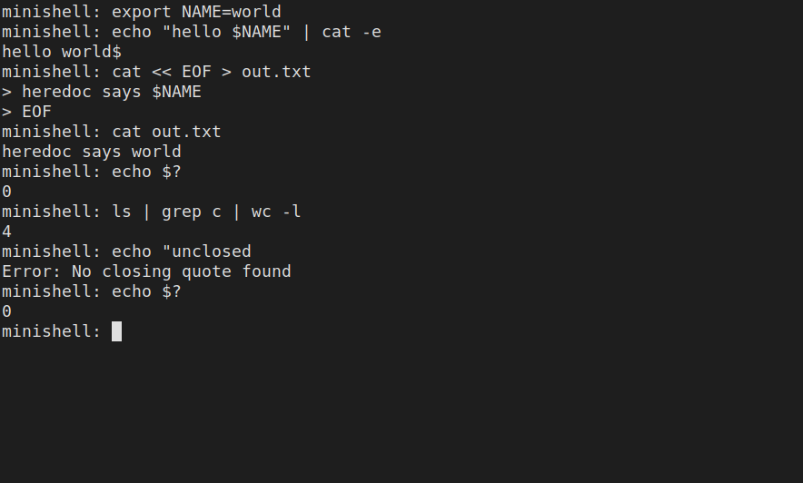

# minishell

A small Unix shell written in C. It reads a command line, parses it, and runs it with pipes, redirections and builtins, in the style of bash.

This is a school project from the Hive Helsinki (42 school) curriculum. It was done in a pair.

## Features

- Interactive prompt with command history (GNU readline).
- Runs programs found through `PATH`, or by relative or absolute path, using `fork` and `execve`.
- Pipelines with any number of commands: `ls | grep c | wc -l`.
- Redirections: `<` input, `>` output, `>>` append.
- Heredoc: `<<` with a delimiter. If the delimiter is quoted, the body is not expanded. If it is not quoted, `$` variables in the body are expanded.
- Single and double quotes.
- Environment variable expansion with `$VAR`, and `$?` for the last exit status.
- Seven builtins: `echo`, `cd`, `pwd`, `export`, `unset`, `env`, `exit`.
- Signals:
  - `Ctrl-C` at the prompt gives a fresh prompt line.
  - `Ctrl-\` is ignored at the prompt.
  - `Ctrl-C` in a heredoc stops the heredoc.
  - `Ctrl-C` on a running command stops it and `$?` becomes 130.
  - Child processes get the default signal behaviour.
- Syntax checks for unclosed quotes (prints `Error: No closing quote found`) and bad pipe placement.
- Exit codes are tracked and available through `$?`: 127 for command not found, the command's own code otherwise.

## Build and run

You need `cc`, `make` and the readline library (on Debian/Ubuntu: `libreadline-dev`). The Makefile links readline with `-lreadline -L ~/.brew/opt/readline/lib`, which is the path on the Hive school machines. On Linux that directory does not exist, but the linker ignores it and finds the system readline, so it builds as is (checked on Ubuntu 24.04, gcc 13). If your readline lives elsewhere, change `RLFLAGS` in the Makefile.

```
cd current_version
make
./minishell
```

Other targets: `make clean`, `make fclean`, `make re`. The binary is called `minishell`. It takes no arguments.

Example input:

```
export NAME=world
echo "hello $NAME" | cat -e
cat << EOF > out.txt
some text
EOF
echo $?
```

A recorded run of this input, plus a pipeline and an unclosed quote:



## Project layout

```
current_version/
  Makefile
  headers/                  minishell.h, get_next_line.h
  libft/                    our own C library (built as libft.a)
  readline.supp             valgrind suppression file for readline leaks
  source_files/
    main_signal_and_execution/   main loop, signals, forking, execve
    split_and_cleaner/           splitting the line, quotes, $ expansion
    setup_and_data_handling/     command list, pipes, redirects, heredoc, env list
    builtins/                    echo, cd, pwd, export, unset, env, exit
  Doxyfile, html/, latex/   generated Doxygen documentation
tests/                      small test programs and files used during development
```

`current_version` is the final version. The source files carry Doxygen comments.

## How it works

1. The main loop reads a line with readline and adds it to the history.
2. The line is split into tokens. Quotes and `$` expansion are handled in the cleaner step.
3. Tokens are typed: command, argument, pipe, each redirection kind, builtin.
4. For each command a child data record is built: its pipe ends, input and output files, and its command path.
5. Each command runs in its own child process.
6. The parent waits for the children and stores the exit status.

The last exit status is kept in a hidden `?` entry of the environment list. A global `g_exit_value` is used by the signal handlers.

## Authors

- Armin Kuburas (ArminKuburas): 180 of 275 commits (about 65%).
- Taneli Valimaki ([Tuubeloid](https://github.com/Tuubeloid)): 95 commits.

Commit counts come from `git shortlog` and include all author names each person committed under.

## Known limitations

- No `&&`, `||`, `;`, wildcards (`*`) or subshells. These were not part of the project.
- The Makefile is set up for the Hive macOS readline location (it still builds on Linux, see above).
- After an unclosed-quote error `$?` stays 0 instead of 2.
- `cd /tmp && pwd` is accepted without an error but nothing runs.
- A short valgrind run (with `readline.supp`) still reports a few small leaks (76 bytes in 5 blocks, from the environment list copy and `cd`).
- There is no automated test suite in the repo.
